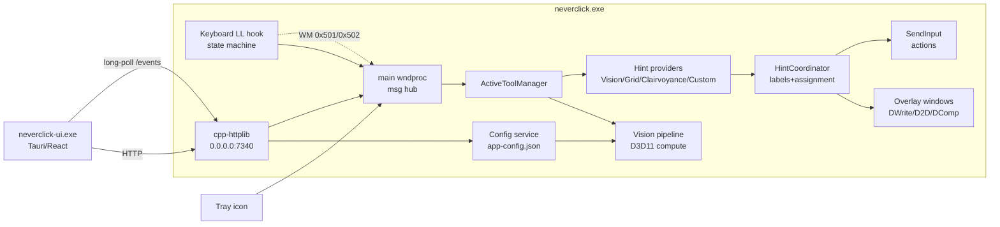
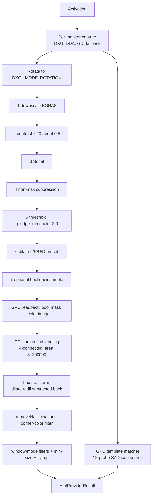

# Neverclick 0.4.1 — Reimplementation Specification

## 0. Brief for the implementing agent (read this first)

**What you are building**: a Windows x64 desktop app that replaces the mouse with keyboard hints.
Press a hotkey → capture the screen → detect "clickable" elements with classical computer vision →
overlay 1–4 character labels → typing a label performs a mouse action at that element. Plus window
management, scrolling, sticky hints, a settings GUI and an updater.

**Hard technical requirements**:
- Windows 10/11 x64. Core in C++17/20 with Win32 + **D3D11 compute shaders** + Direct2D/DirectWrite +
  DirectComposition; input via one global `WH_KEYBOARD_LL` hook and `SendInput`.
- **No neural network.** The original ships `onnxruntime.dll` but never calls it; the CV is 8 hand-written
  HLSL compute shaders (7 edge-detection stages + 1 template matcher) + CPU connected components — §4,
  Appendix E.
- Install to **Program Files** with manifest `asInvoker` + `uiAccess="true"` + `dpiAware True/PM`, and sign
  with an Authenticode certificate whose subject matches the machine's `uiAccess` trust — that trio is what
  lets the app click into elevated windows (§6.4). No elevation APIs are used at runtime.
- Settings GUI: Tauri 2.x + WebView2 shell. **The shipped frontend bundle is not redistributable and is not
  present in this tree** — the UI must be rebuilt (§8); `notes/report-config-ui.md` records its structure,
  routes and schemas.
- Installer: Inno Setup, silent-update flags `/VERYSILENT /NORESTART /SUPPRESSMSGBOXES /LAUNCHAPP=1 /MERGETASKS="!startup"` (§11).

**Critical algorithms**: CV pipeline §4 (exact constants; shader math in `notes/report-shaders.md`);
hint alphabet/ordering/assignment §5; injection sequences §6.2 (including the `dwExtraInfo = 0x147d`
self-injection marker and the Win-key replay trick, without which the Start menu breaks);
hotkey state machine §6.1; REST + config schema §7.

**Definition of done**: Appendix D — run the *original* `neverclick-ui.exe` against your core (it is a pure
HTTP client) and compare overlays against the original build on the same screens.

**Everything else** (protocol, JSON contracts, ids, factory defaults, gap register, sha/evidence pointers)
is in §3–§22 and the four subsystem reports listed in §15. A feasibility audit of this spec (what is
implementation-ready, what needs tuning, what is deliberately stubbed) is in `notes/AUDIT.md`.

---

Audience: an engineering agent implementing an equivalent application **from scratch** (no access to the
original binary). Everything here is derived from static reverse engineering of
`neverclick-setup-0.4.1.exe` → `neverclick.exe` (+ `neverclick-ui.exe`); see §15 for the evidence map.

Conventions used below:
- `[V]` = verified in the binary (function/constant/string evidence in the cited report).
- `[I]` = inference (reasoned, not directly observed) — a reimplementation may choose differently.
- References like `RV §4.2` mean `notes/report-vision.md` section 4.2 (same for RH=hints, RI=interaction,
  RC=config/UI).

---

## 1. Product definition

**Neverclick** is a Windows-only keyboard-driven mouse replacement. Pressing a global hotkey captures
the screen, detects "clickable" UI elements with local computer vision, overlays **hints** (short
key-combo labels) on every detected element, and then performs mouse actions (move/click/scroll/etc.)
when the user types a hint or uses keyboard actions. It works in any application because it uses raw
pixels rather than accessibility APIs, with an optional accessibility-API mode ("Clairvoyance") as a
backup. It runs fully offline, event-driven (no background polling), and installs to Program Files with
`uiAccess="true"` so it can act on elevated windows.

Non-goals for v0.4.1 parity: drag-and-drop and text-highlight-between-hints (documented "coming soon" and
verifiably absent `[V]` RI §Mouse), macOS/Linux/ARM.

### 1.1 User-visible behavior contract (must match)

| # | Behavior | Detail |
|---|---|---|
| B1 | Global hotkey activation | Default `Ctrl+Enter` = Left Click Tool, `Alt+Enter` = Ctrl+Left Click (per upstream docs). Hotkeys are user-configurable and stored (`RC §Settings`, `RI §Config`). |
| B2 | Hint overlay | Detected elements get a green-outlined **bounding box**, a **hint label** (1–4 chars; 2 in practice) drawn on a light chip, and a **target** point (ring) defaulting to box center (`RV`, `RH`, images in `notes/public/images/`). |
| B3 | Type a hint → action | Typing a hint combo moves the cursor to the target and performs the tool's mouse action; a thin green guide line connects label → target when they are apart. |
| B4 | Target adjustment | Arrow keys / `Shift+JIKL`: first press snaps to box edge midpoint, later presses nudge (±4 px, ×DPI). Number row `1`–`9`: linear position across the box (`1`=left edge, `5`=center, `9`=right edge at mid-height); `0` unbound. `RH §Follow-up`. |
| B5 | Vision modes | `Tab` toggles Window/Full-screen field of view; `2`-mode switching by keybind: default `Ctrl+Enter` tool = Vision, `[` = Clairvoyance (UIA), `;` = Grid (`README`, `RI`, `RH`). |
| B6 | Window management | Focus by direction (`Shift+W/A/S/D`), cycle overlapping (`Shift+Q` backward / `Shift+E` forward — the binary's compiled defaults; README's "Shift+W cycles" is a doc typo), switch to window behind (`Shift+Z`), move window to monitor/desktop, snap/tile (`RI §Window`). |
| B7 | Multi-select | `'` dual select, `Shift+'` multi select, `Ctrl+'` path select, `Enter` finishes (`RH`, `RI`). |
| B8 | Sticky hints | Save hints that can be re-clicked later, re-anchored by screen position or by image re-matching (`RH §Sticky`, `RC`). |
| B9 | Tray + config app | Tray icon (Open / Suspend-Resume / Sleep-Wake / Exit) opens a separate settings app (Tauri) with hotkey editing, appearance, detection settings, import/export (`RC`). |
| B10 | No idle CPU | Detection runs only on activation; no timers in the vision path (`RV §Cadence`). |

---

## 2. System architecture

Two processes + two helper executables (`RC §Processes`, `RI`):

```
neverclick.exe        core engine: tray, input hooks, CV, overlays, window mgmt, REST server, config store
neverclick-ui.exe     settings GUI: Tauri 2.x + WebView2 + React/AntD, pure HTTP client
neverclick-updater.exe post-exit relauncher/installer runner (waits PIDs, ShellExecute)
neverclick-graphics-check.exe one-shot DXGI/D3D11/D2D capability probe (JSON stdout)
```



Key architectural rules to preserve:

- **Single global low-level keyboard hook** (`WH_KEYBOARD_LL`) on a dedicated thread; hotkey state
  machine with three states; all input marshalling via `SendMessage(hookWnd, WM_USER+1, 0, closure)` (`RI §1`).
- **Event-driven detection**: hook → posted message → tool arm → session → `HintCoordinator::run` →
  provider `run(FovMode)` → one capture-detect-return pass. No vision timers (`RV §Cadence`).
- **Config in the core**, REST API for the GUI, long-poll event stream for change notification (`RC §IPC`).
- **Injection only via `SendInput`**, with a self-injection marker in `dwExtraInfo` (`RI §Mouse`).
- IoC-free design is acceptable; the module boundaries below must exist.

---

## 3. Data model

### 3.1 Geometry and detection

```
Box      { int32 x0, y0, x1, y1 }          // screen physical px, top-left/bottom-right
Target   { Box box; vector<Box> slots; ... }   // slots = clickable sub-areas (words/segments)
HintProviderResult { vector<Target> targets; uint8 kind /*0=assign,1=passthrough*/; ...; int status /*0 fresh,1 cached,2 fallback*/ }
CpuImage { uint32 w, h, stride; const uint8* pixels /*BGRA8*/ }
```

### 3.2 Input / hotkeys (`RI §3`, `RI §Config`)

```
HotkeyEntry {
  int ctrlReq, altReq, shiftReq, winReq;   // 0=none, 1=left, 2=right, 3=either
  int vk;                                  // trigger virtual key
  bool present;                            // must be true to participate
  Action* action;                          // activate()/execute()/deactivate()/GetName()
  char mode;                               // 0 = tool activation, 1 = direct action, -1 invalid
  bool enabled;
}
```

Persisted JSON (`hotkey-config.json.gz`, gzip'ed JSON, schema-versioned `[V]` `RC §Hotkey format`):

```json
{
  "version": 2,
  "hotkeys": [
    { "type": "hotkey", "id": 1, "isEnabled": true,
      "keyCombo": { "key": "KeyA", "ctrl": "Either", "shift": "Left" },
      "binding": { "classId": "BasicMouseActionTool", "...": "tool-specific params" } }
  ],
  "sharedKeybinds": { "<classId>": [ { "key": "KeyJ", "shift": "Either" } ] }
}
```
`type:"error"` entries carry `{title,description,raw}` and are preserved visibly (recovery flow in UI).

### 3.3 Enums (exact domains)

| Enum | Values |
|---|---|
| `FovMode` | `0 Window`, `1 Monitor`, `2 AllMonitors` (default AllMonitors) `[V]` |
| `detectionModel` | `0 Balanced` (default), `1 Narrow`, `2 UltraNarrow`, `3 Wide` `[V]` |
| `hintAssignment` | `0 Random`, `1 CenterFirst` (default) `[V]` |
| `hintPlacement` | `0 Centered` (default), `1 BelowCenter` `[V]` |
| `graphicsPreferencePolicy` | `0 LetNeverclickDecide` (default), `1 LetWindowsDecide`, `2 HighPerformance`, `3 PowerSaving`, `4 Manual` `[V]` |
| `appBarTheme` | 20 named themes: Graphite(default), Peridot, Amber, Obsidian, Moss, Glacier, Basalt, Jade, Cobalt, Pewter, Marble, Amethyst, Porcelain, Frost, Opal, Sapphire, Celadon, Aquamarine, Tanzanite, Topaz `[V]` |
| `keyboardLayoutPolicy` | `0 Auto`, `1 Manual` (default per ctor; report-hints inferred Manual) `[V]/[I]` |
| `theme.styleName` | 46 palette names; default `"Nevermore"` `[V]` |
| Hotkey state | `0 Active`, `1 Suspended`, `2 Sleeping` `[V]` |
| Modifier requirement | `0 none, 1 left, 2 right, 3 either` `[V]` |

---

## 4. Computer-vision pipeline (Neverclick Vision)

**There is no neural network in the original.** The shipped `onnxruntime.dll` is inert: `OrtGetApiBase`
is called once from a CRT initializer and the resulting pointer is never read (verified three ways)
(`RV §3.1`). A reimplementation must not depend on a model; implement the classical pipeline below.



### 4.1 Capture (`RV §4.1`)

- Per monitor: **DXGI Desktop Duplication** (`IDXGIOutput1::DuplicateOutput`) with:
  `AcquireNextFrame` 0 ms timeout with busy retry up to 1 s; on `DXGI_ERROR_ACCESS_LOST` recreate the
  duplication; on 2+ consecutive failures mark the monitor dead ("never delivered a frame after N attempts").
- Fallback per monitor: `GetDC(NULL)` + `BitBlt(SRCCOPY)` → `ID3D11Texture2D` `DXGI_FORMAT_B8G8R8A8_UNORM`.
  There is **no** `PrintWindow` / per-HWND capture: window mode crops the desktop capture.
- Skip software adapters (`VendorId 0x1414, DeviceId 0x8c`).
- Correct rotation per monitor (`TextureOps::Rotate`: 90/180/270 via matrix render; 0/1 = identity AddRef).
- DPI affects rect math only (`scale = dpi/96`), not pixels; use per-monitor DPI and a DPI-aware context.
- Window-mode FOV = foreground window's `DWMWA_EXTENDED_FRAME_BOUNDS`; only "relevant" windows qualify
  (visible, not cloaked, not iconic, frame ≥ 2 px, non-empty title). If the foreground window is a shell
  surface (`Shell_TrayWnd`, `Shell_SecondaryTrayWnd`, `Progman`, `WorkerW`, `Windows.UI.Core.CoreWindow`,
  desktop/shell window) force `FovMode = AllMonitors`.
- Sources intersecting `FOV grown by 10 px` are processed.

### 4.2 GPU stage chain (`RV §3.3, §4.2, §4.3`)

7 embedded `cs_5_0` DXBC compute shaders (16×16 thread groups) sharing an ~80-byte constant buffer:

```
PipelineConstants {
  uint  g_width, g_height;            // capture size
  float g_dpi_scale;
  float g_edge_threshold;             // 2.0
  uint  g_scaled_width, g_scaled_height;
  float g_coord_scale;
  uint  g_pad0;
  uint  g_label_width, g_label_height;
  uint  g_min_blob_area;              // 3
  uint  g_pad1;
  int   g_dilate_left, g_dilate_right, g_dilate_up, g_dilate_down;
  float g_contrast;                   // 2.0
  float g_contrast_midpoint;          // 0.5
  uint  g_pad2, g_pad3;
}
```

Stage order and gates:

| # | Stage | Gate |
|---|---|---|
| 1 | downscale (→ BGRA8 scaled color) | always |
| 2 | contrast `out = (in − 0.5)·2.0 + 0.5` (in-place) | `g_contrast != 1.0` (always, =2.0) |
| 3 | Sobel | always |
| 4 | non-max suppression (thin edges) | always |
| 5 | threshold (`g_edge_threshold = 2.0`) → boolean | always |
| 6 | anisotropic dilate, radii from `detectionModel` preset | any radius ≥ 1 |
| 7 | optional boolean downsample (halves mask → label dims) | label dims ≥ 2 `[I]` |

`detectionModel` presets (dilate L/R/U/D; all other params identical) `[V]`:

| model | L | R | U | D |
|---|---|---|---|---|
| Balanced (default) | 2 | 2 | 1 | 1 |
| Narrow | 1 | 1 | 1 | 1 |
| UltraNarrow | 1 | 0 | 1 | 0 |
| Wide | 3 | 3 | 1 | 1 |

Readback: bool mask into a staging texture (Map/READ, row copy of `label_width` × `label_height` bytes)
and the scaled BGRA color image (`scaled_w×4` stride). Labeling runs under a parallel-for per monitor.

### 4.3 CPU labeling and box production (`RV §4.4, §4.5`)

1. **4-connected union-find** (path compression, bbox merge) over the boolean mask; per-pixel bbox table.
2. Components with **pixel count ≤ 10 are discarded** (minimum 11).
3. Area filter: keep `3 ≤ area ≤ 200 000` px.
4. Transform mask bbox → capture space, **subtracting the dilate radii back** so the box reflects the
   pre-dilation extent:
   `x0' = x0·s + L·s2`, `y0' = y0·s + U·s2`, `x1' = x1·s − R·s2`, `y1' = y1·s − D·s2` `[V, float identities I]`.
5. **`removeHallucinations`** (config flag, default **true**): for each box, sample the 4 corner pixels of
   the color image at probe insets **{0, 2, 5, 10} px**; keep the box at the first inset where the four
   corner RGB triples contain **fewer than 3 distinct values**; if every inset stays multi-colored, drop
   the box.
6. Window-mode post-filters: keep only boxes whose corners all lie inside the foreground-window rect;
   drop boxes whose center is inside the frame rect but any corner is outside `rect ± 3 px`
   (border-straddling); min-size filter: keep iff
   `(h < 3 ∧ 9 ≤ w < 20)` **or** `(area ≥ 30·s ∧ w ≥ s ∧ h ≥ s)` where `s` = mask→screen scale;
   finally clamp to the capture rect inset by (2, 2, 3, 3) px.
7. Boxes are appended per monitor as 16-byte `{x0,y0,x1,y1}` in **screen coordinates**.

### 4.4 Icon detection: GPU template matcher (`RV §4.6`)

Used for window/taskbar/desktop icon hints (the "Perfect Desktop and Taskbar Icon Detection" setting):

- Haystack = monitor capture (must be BGRA8); needle = `CpuImage` (cached window-icon bitmap, keyed by
  FNV-1a of the executable path).
- **12 fixed relative probes** of the needle: `x ∈ {0.05, 0.2, 0.35, 0.5, 0.65, 0.8, 0.95}·w`,
  `y ∈ {0.05, 0.25, 0.5, 0.75, 0.95}·h` (grid + crosshair), packed as `{int32 x,y; u8 B,G,R,A}×12`.
- Match criterion: SAD over the 12 probes; max error per probe = 3·255 = 765;
  budget `= needle_w · 765 · needle_h · (1 − tolerance)` with tolerance passed as `24` (`0.24` roughly);
  candidates tiled into 16×16 groups (≤ 0x1000 groups); group-best error copied back, thresholded by
  `maxErr·(1−tolerance)`; **overlap-based NMS**; hit box = `{x, y, x+needle_w, y+needle_h}`;
  `score = 1 − errorSum / (needle_w·765·needle_h)`.
- Needle sources: window icons (per app), refreshed geometry for taskbar/desktop icons from UIA
  (`RI §Icon refresh`).
- Per-monitor degradation: if the matcher fails to initialize for a monitor, log and continue
  ("Template search will be unavailable there").

### 4.5 Cadence

One capture→detect→return pass per activation; no timers, no polling, no continuous loop. Provider
results are cached in the coordinator keyed by provider cache-key (FNV-1a of `{detectionModel,
removeHallucinations}` and provider identity) and invalidated on mode/FOV/config changes (`RV §4.5`,
`RH §2.1`).

---

## 5. Hint generation, assignment and geometry

### 5.1 Alphabet and priority (`RH §3.1`)

- The hint alphabet = the enabled entries of config `keyCodes` (scan codes), in **order** (order ==
  priority), mapped through the active keyboard layout to Unicode, keeping **only alphabetic**
  characters (`GetStringTypeW & C1_ALPHA`).
- `keyOverrides` map (`{position: "On"|"Off"}`): `Off` drops a key, `On` force-includes without the
  letter filter.
- Fallbacks: if no letters resolve → use all resolved keys (warn); if still empty → Latin `A–Z` (warn).
- Validation: ≥ 2 enabled keys required ("At least 2 keys must stay enabled for hints"); `keyCodes` must be
  non-empty and duplicate-free.
- **Default 48-key priority order (scan codes)** `[V]`:
  `J F K D L S ; A V M E I C , N O W R U G H T B Y X . Q P Z / ' D4 D7 D3 D8 D2 D9 [ ] D1 D0 D5 D6 - = \ \``
  → default 26-letter alphabet: `J F K D L S A V M E I C N O W R U G H T B Y X Q P Z`
  (the settings GUI shows this as a heat map; the default is what the app ships).

### 5.2 Depth

`d = min d ∈ [1,4]` such that `|A|^d ≥ (existing_combos + number_of_slots)`; 2 for typical screens
(`RH §3.2`).

### 5.3 Combo ordering ("convenience")

Deterministic given the alphabet — score is `(max key index, sum of key indices)`, not a weighted cost
(`RH §3.3`):

```
out = []
for g in 1..|A|:                      # g = rank of the worst (highest-index) key used
    group = []
    for each combo of length d with max(index) == g-1 (all combos over indices 0..g-1):
        group.append(combo)           # deduped
    stable-sort group ascending by sum(indices)
    append group to out until needed count reached
```
With the default alphabet the list starts `JJ, FJ, JF, FF, …` (matches the author's description).

### 5.4 Assignment (`RH §4`)

`CenterFirst` (default):
1. reference = center of the foreground window's DWM extended frame (fallback: center of the first box);
2. build records `{target, slot, dist2}` for **every slot** with `dist2 = (int)(dx*dx + dy*dy)`;
3. sort ascending by `dist2`; pair combo *i* ↔ record *i*;
4. leftover slots (alphabet exhausted) → the farthest slots get **no** hint
   ("Hint alphabet covers only N of M targets; the farthest targets get no hints").

`Random`: same slot iteration in natural order, combos shuffled with MT19937.

Assignment is per **slot**, so multi-slot targets can receive several hints (word-level boxes).

### 5.5 Providers and merging (`RH §2.4, §2.5`)

| Provider | Behavior |
|---|---|
| VisionProvider | the CV pipeline of §4; `FovMode` window/monitor/all-monitors (shell windows force all-monitors) |
| GridProvider | uniform grid over the FOV: `spacing = 100 px × dpi_scale`, `cols = floor(W/s)`, `rows = floor(H/s)`, cell = `W/cols × H/rows` (float), truncated int, row-major; per-monitor grids (per-monitor DPI) in AllMonitors |
| FullScreenGridProvider | grid over all monitors, one cell vector per monitor, same cell math |
| UiAutomationProvider (Clairvoyance) | foreground-window-only: `FindAllBuildCache(Descendants, control-view condition, cache: BoundingRectangle)` → all control-view descendant rects; inflate fg rect ±2 px, clip; boxes weight 1; invalid/no fg → empty result |
| CustomProvider | stored/supplied boxes, `kind = 1` → pass-through **without** combo assignment (used by sticky hints) |

Coordinator semantics: primary provider runs first; **only if its target vector is empty** is the
secondary provider consulted, and the result status is set to 2 (secondary fallback). Cache hits set
status 1. Mode switches (`[` Clairvoyance, `;` Grid, Vision) replace the provider and clear the cache.

### 5.6 Target geometry (`RH §6`, `RH §Follow-up`)

- Default target = box center (`(x0+x1)/2, (y0+y1)/2`, integer truncation).
- `hintPlacement` only affects where the label chip is drawn (centered on the box vs below-center).
- **Digits 1–9** → `SnapTargets{percentX = (d−1)/8, percentY = 0.5}` (exact floats 0, 0.125, …, 1.0);
  executor: `x = box.left + (int)(box.width·percentX + 0.5)`, `y = box.top + (int)(box.height·percentY + 0.5)`
  — linear percent, round-half-up, no glyph/word snapping, applied to all slots. Digit `0` unbound.
  Letters `a…i` = 3×3 percent anchors `[I]`.
- **Arrows / Shift+JIKL** → `MoveTargets{strideX, strideY}` with stride ±4 px (a second chord = ±2 px):
  * first press for a slot (target still at its default) **snaps by the stride sign**:
    `<0` → box left/top edge, `0` → center line, `>0` → box right/bottom edge
    (horizontal moves pin `y = (top+bottom)/2` → edge midpoints);
  * subsequent presses add `stride × dpi_scale` px (no clamping);
  * grid cells (kind 2) always move, never snap.
- Action ids observed (dispatch numbering): 1 Clear, 2 UndoHintSelection, 4 RevealOverlappedHints,
  5 ToggleHintPlacement, 6 Grid, 7 Clairvoyance, 8 Vision, 9 Refresh, 10 ToggleFieldOfVision (0x0a),
  0x0b SetFieldOfVision, 0x0c FocusWindow, 0x0e MoveTargets, 0x0f SnapTargets, 0x10 CycleWindows,
  0x11 FocusWindowBehind, 0x12 SearchForWindow, 0x15 FinishSelection `[V]`.

### 5.7 Rendering the overlay (`RH §7`)

- DirectWrite text (`IDWriteFactory3`, custom font collection loaded from `<exe>/fonts` — 11 bundled TTFs;
  default `hintFontName = "Inter"`), Direct2D bitmap render target + glow effect, DirectComposition
  surfaces; layered windows (`WS_EX_LAYERED`), window classes
  `Neverclick`, `NeverclickLayer`, `NeverclickWindowBorder`, `NeverclickAnimationWindow`,
  `NeverclickAnimationOverlay`, `NeverclickAppBar`.
- Label chip: light (white) rounded background, dark text, positioned on the box edge
  (Centered) or below it (BelowCenter); optional uppercase transform (`enableUppercaseHints`) applied
  **at rasterization only**.
- Bounding boxes: `drawBoundingBoxes`, `boundingBoxOpacity`, `drawHintBorders`, `drawGlow`; box/target/guide
  color is green (`#3ee96b`-family) per the official images (`notes/public/images/VISUAL-NOTES.md`).
- Layout caches: per-font-size metrics and per-label glyph-metric tries (see `RH §7` for structure); a
  faithful reimplementation only needs a working cache, not the same layout.

---

## 6. Input layer

### 6.1 Hook and state machine (`RI §1–§5`)

- Exactly **one** global `SetWindowsHookExW(WH_KEYBOARD_LL, cb, NULL, 0)` on a dedicated thread with its
  own message loop (`InputHookThread`); hook/unhook/isHooked marshal to that thread via
  `SendMessage(hwnd, WM_USER+1, 0, closure)`; exceptions propagate via `exception_ptr`.
- Hook entries form an ordered vector of `{id, callable}`; the LL callback stops at the first entry that
  returns 1 (swallow); otherwise `CallNextHookEx`.
- **Self-injection filter**: every injected keyboard/wheel `INPUT` carries `dwExtraInfo = 0x147d`; events
  with that marker are ignored (never matched, never replayed). Mouse move/button INPUTs carry 0.
- **Win-chord suppression**: when a Win-containing chord was swallowed and the user releases Win with no
  Ctrl/Alt/Shift held, synthesize `[LCONTROL down, LCONTROL up, Win up]` in one `SendInput(3)` and
  swallow the Win key-up (prevents the Start menu from opening).
- Modifier keys (L/R Ctrl, Alt, Shift, Win) are never captured in tool mode and never trigger chords.
- **Chord match**: pressed `vk` equals the chord's `vk` **and** a live 8-bit `GetAsyncKeyState` snapshot
  (`bit0 LCTRL, 1 RCTRL, 2 LALT, 3 RALT, 4 LSHIFT, 5 RSHIFT, 6 LWIN, 7 RWIN`) satisfies all four
  requirement codes.
- On match → `PostMessage(mainWnd, 0x501, heap{20-byte chord}, 0x147d)`; the wndproc re-matches entries
  and either arms a tool (mode 0) or executes the action directly (mode 1); frees `wParam` on all paths.
- **Three states**: `0 Active` (all enabled entries hooked), `1 Suspended` (only `SuspendNeverclick`
  chords), `2 Sleeping` (only `SleepNeverclick` chords); toggles are
  `state = (state != 1) ? 1 : 0` (suspend/resume) and `state = (state == 2) ? 0 : 2` (sleep/wake), each
  followed by an atomic hook rebuild (unhook old id → hook new).
- While hints are up, **all non-modifier key down/up are swallowed**; each down posts
  `0x502 {modifierSnapshot8, vk}`; tool binding vectors (stride 0x88: `+0x10 = vk`, `[0..3]` mod reqs,
  `+0x80` active flag) consume those events.
- **Release trap**: on tool close, snapshot the held-key set, install a trap hook that swallows those
  key-ups and fires the deferred close when the set empties, or after ≈1.001 s.
- Overlay lifecycle: arm → `ShowWindow(SW_SHOWNA)` both overlays + post `0x50c`; close → deactivate,
  `SW_HIDE`, post `0x50c`. Re-pressing the same chord toggles the tool off (settle path).

### 6.2 Mouse and scroll injection (`RI §Mouse`)

All input via `SendInput`; no `mouse_event`; one `SetCursorPos` (window-warp helper, only when the cursor
is outside the foreground window frame).

| Operation | INPUT sequence |
|---|---|
| absolute move | 1 INPUT: `dx = (int)(65535/(SM_CXVIRTUALSCREEN−1)·(x−SM_XVIRTUALSCREEN))`, same for dy; `flags = 0xC001` (MOVE\|ABSOLUTE\|VIRTUALDESK); truncating, `extra=0` |
| left click | `flags 0x2` (down), `0x4` (up) |
| right click | `flags 0x8`, `0x10` |
| middle click | `flags 0x20`, `0x40` |
| double / triple | literal `[0x2,0x4] ×2 / ×3` in one vector |
| wheel | `mouseData = ±120·lines`; `flags 0x800` (WHEEL) or `0x1000` (HWHEEL); dir 0/1 = vertical +/−, 2/3 = horizontal −/+ |
| modifier wrap | VK 0x11/0x10/0x12 with `extra=0x147d`, released in reverse order |
| modifier-neutralized batch | if any modifier is held: `[Ctrl↓↓ Ctrl↑ if Alt/Win held] [modifiers up] [payload] [modifiers down reversed]` — one SendInput so held modifiers never alter injected combos/wheel |
| hint click | `[move][modifiers down][click][modifiers up reversed]`, one batched SendInput or per-INPUT, sequenced by a countdown queue |
| ReturnToOrigin | capture `GetCursorPos()` at dispatch; after the click events enqueue an absolute-move replay of the saved point (sticky delay `d = 2 − flag` ticks) |
| ClickOnWindow | move → left-click animation → `Hold` (`flags 2`, `SendInput(1)`) → `Lift` (`flags 4`, `SendInput(1)`), enqueued as a pair (never unpaired — no drag) |

Scroll warp: only if the cursor is outside the foreground window frame, move first to
`(frame.left + w·fracX, frame.top + h·fracY)` with a disappear animation at the old position.

### 6.3 Window management (`RI §Window`)

- **Focus by direction**: geometric half-plane picker vs the foreground rect; perpendicular margin =
  15 % of fg height (left/right) or width (up/down); prefer candidates in the aligned band; tie-break by
  minimum distance; returns optional HWND.
- **Cycle windows**: `Forward` = scan z-order top→bottom, first eligible, then send the previously focused
  window to the bottom (`SetWindowPos(oldfg, HWND_BOTTOM, 0x213)`); `Backward` = scan bottom→top, first
  eligible, no z-reorder. Scopes: through-overlapping / same-monitor / across-monitors / all-windows.
- **Eligibility filter**: visible, class ≠ `Windows.UI.Core.CoreWindow`, not cloaked, not shell,
  area > 1 px², non-empty title, not minimized.
- **Move to monitor**: neighbor = exact edge abutment (e.g. `candidate.right == current.left`), first
  match, **no wrap-around**; restore from maximized/minimized before moving; preserve relative position
  (clamped); apply DPI-aware `SetWindowPos(..., 0x204 /*NOZORDER|NOOWNERZORDER*/)`, twice when DPI
  awareness == 2 (per-monitor).
- **Snap**: single jump to `union(old, new)` rect with `0x204` (perceived motion comes from the animation
  queue).
- **Tiling**: assign windows to grid cells by nearest center; styles `Fit` (scale = min(cellW/w, cellH/h)
  centered) vs `Stretch` (fill); pre-restore maximized windows.
- **Virtual desktops**: switch/create/close = injected `Ctrl+Win+← / → / D / F4`; move window to desktop =
  `IVirtualDesktopManager` COM.
- **Animations**: events pushed to an animation queue consumed by a dedicated AnimationWindow thread,
  gated by `enableWindowAnimations` (destroy queue/thread when disabled).

### 6.4 UIA usage and elevation (`RI §UIA & elevation`)

- **Pure client**: one `CoCreateInstance(CLSID_CUIAutomation)`; caches only `BoundingRectangle`
  (cache-request property `0x7531`) and uses `ControlType == ListItem (50007)` for desktop icons.
  No UIA provider is exposed (no `WM_GETOBJECT`, no `IRawElementProvider`).
- **Clairvoyance**: all control-view descendants of the foreground window → rect boxes (no type filter,
  no element names — hint labels are generated, not element names).
- **FailSafeUiAutomationManager**: `requestWindowControls(notifyHwnd, messageId)` returns a ticket,
  delivers an immediate `{ticket, rects}` payload (possibly empty) via `PostMessage`, and subscribes
  one-shot to `UIA_AsyncContentLoadedEventId (0x4E26)` to re-deliver when content loads;
  `cancelWindowControls` removes the handler. **No timeout** — the third argument is the window message
  id, not a timeout. Purpose: guaranteed delivery even when the bounding-box retriever failed.
- **Icon geometry refresh**: taskbar via `SetWinEventHook(0x8000..0x800b)` filtered to tray classes →
  coalesced async `FindAllBuildCache(Descendants)`; desktop via shell change notification +
  `EnumChildWindows` for `SysListView32`/`FolderView` → `FindAllBuildCache(Children, ListItem)`; both
  cached under mutexes.
- **Elevation**: manifest `asInvoker` + `uiAccess="true"` + `dpiAware True/PM`; no runtime elevation APIs;
  UIPI bypass = uiAccess + install under Program Files + Authenticode signature. `ShellExecuteExW` with
  `runas` is used only to launch user-chosen target apps.

### 6.5 Chrome: tray, audio, animations, updates (`RI §Tray`, `RI §Config`)

- Tray: `NOTIFYICONDATA.uCallbackMessage = 0x401`; `WM_USER+1` callback; right-click builds a popup with
  `&Open` (default item, id 0xd1), separator, Suspend/Resume (0xd2, label/check depend on state),
  Sleep/Wake (0xd3), separator, Exit (0xd0). State changes swap the tray icon (NIM_MODIFY). Exit =
  clean shutdown; `TaskbarCreated` re-adds the icon after Explorer restart.
- Audio: `SDL_Init(SDL_INIT_AUDIO)` at boot (no SDL audio device is ever opened) and
  `PlaySoundA("%WINDIR%\\Media\\Speech Sleep.wav" | "Speech On.wav", NULL, SND_ASYNC|SND_NODEFAULT|SND_FILENAME)`
  on sleep/wake, rate-limited. The two embedded WAV resources (ids 301/302) are loaded but **never played**
  (vestigial); notification feedback is an animated on-screen toast, not a sound.
- Update check: hourly `SetTimer` (3 600 000 ms) → WinHTTP POST `https://www.neverclick.com/api/version`
  with `{instance_id, app_version, locale}`; response
  `update{available, latest_version, download_url, sha256, release_notes, release_notes_url}` copied
  verbatim (no client-side version comparison); download + sha256 verify in the core, then spawn the updater.
- **Notifications** are on-screen **animated toasts** (queued on the animation window), gated by
  `enableNotifications` (and `showStartupNotification` for the startup one) — not sounds. Only sleep/wake
  play Windows' `Media\Speech {Sleep,On}.wav`; the embedded WAV resources are dead weight.
- **Screen-capture visibility**: `enableVisibilityToScreenCapture` (default true) sets
  `SetWindowDisplayAffinity(overlayHwnd, WDA_NONE)`; false sets `WDA_EXCLUDEFROMCAPTURE (0x11)`. While the
  core captures the screen for detection it temporarily excludes its own overlays so hints cannot feed back
  into the CV input, then restores the user's setting.

---

## 7. Configuration service

### 7.1 Files and locations (`RC §Settings`, `RI §Config`)

- Data dir: `%AppData%\Roaming\Neverclick\` (roaming AppData known-folder + `"Neverclick"`).
- `app-config.json` — plain JSON object (**36 keys**, see table), rewritten atomically; a missing/invalid
  `instanceId` (UUID) is regenerated.
- `hotkey-config.json.gz` — gzip'ed JSON (schema-versioned), siblings
  `hotkey-config.v1.backup.json.gz` (pre-migration copy) and `hotkey-config.corrupt.bak.json.gz`
  (unparsable original preserved).
- Exports (UI): `neverclick-settings.json` = `{version: 2, appConfig, hotkeys (ids stripped), sharedKeybinds}`;
  import accepts `version 1|2` and replaces all three sections (`POST /settings/import`).
- Autostart = a shortcut in the user's Startup folder (managed when `launchAtStartup` toggles);
  **no registry Run key** (the only registry writer is the GPU-preference value).

### 7.2 app-config schema and defaults (`RC §Settings` — authoritative from the default ctor)

| Key | Type / enum | Default |
|---|---|---|
| `instanceId` | UUID string | nil → regenerated |
| `theme.theme` (palette) | 47 Modern / 42 Classic palette names | `"Nevermore"` |
| `theme.styleName` | style template: `"Modern"` / `"Classic"` | `"Modern"` |
| `theme.drawHintBorders` | bool | `true` |
| `drawGlow` | bool | `false` |
| `drawBoundingBoxes` | bool | `true` |
| `boundingBoxOpacity` | f32 0…1 | `1.0` |
| `hintBackgroundOpacity` | f32 0.5…1 | `1.0` |
| `eventDelay` | int ms (UI slider 10…30) | `10` |
| `enableEventBatching` | bool | `true` |
| `enablePerfectDesktopAndTaskbarIconDetection` | bool | `true` |
| `enableVisibilityToScreenCapture` | bool | `true` |
| `launchAtStartup` | bool (legacy alias `runOnStartup`) | `false` |
| `showStartupNotification` | bool | `true` |
| `enableAnimations` | bool | `true` |
| `enableMouseAnimations` | bool | `true` |
| `enableWindowAnimations` | bool | `true` |
| `enableNotifications` | bool | `true` |
| `enableUppercaseHints` | bool | `false` |
| `hintFontSize` | int 8…24 | `16` (ctor value; an earlier pass inferred ~28 — treat 16 as authoritative, `[V]` ctor + UI zod) |
| `hintFontName` | bundled font name | `"Inter"` |
| `keyCodes` | int[] (key positions, priority order) | `[]` → compiled default priority list (§5.1) |
| `keyOverrides` | `{position: "On"|"Off"}` | `{}` |
| `keyboardLayout` | string (layout id) | `""` |
| `keyboardLayoutPolicy` | `Auto=0, Manual=1` | `0 Auto` |
| `hintAssignment` | `Random=0, CenterFirst=1` | `CenterFirst` |
| `enableProgressiveHints` | bool | `false` |
| `hintPlacement` | `Centered=0, BelowCenter=1` | `Centered` |
| `fovMode` | `Window=0, Monitor=1, AllMonitors=2` | `AllMonitors` |
| `graphicsPreferencePolicy` | 5-value enum | `LetNeverclickDecide` |
| `appBarTheme` | 20-name enum | `Graphite` |
| `compactAppBar` | bool | `false` |
| `vision.detectionModel` | 4-value enum | `Balanced` |
| `vision.removeHallucinations` | bool | `true` |
| `stickyHints` | array (see §9) | `[]` |

Validation: `PATCH` is a **partial merge**; errors are HTTP 400 `{code, message, details?}` with codes
`BAD_REQUEST`, `NOT_FOUND`, `INVALID_HOTKEY`, `CONFLICT`.

### 7.3 HTTP API (`RC §HTTP API`)

`cpp-httplib` server bound to **`0.0.0.0:7340` with no authentication** (clients use
`http://127.0.0.1:7340`). Route list to implement (method, path, effect):

| Method | Path | Effect |
|---|---|---|
| GET | `/health` | liveness |
| GET | `/events?cursor=N` | long-poll (≈1 s cap): `{bootId, cursor, events[], resync, goingDown}`; events `hotkeysChanged`, `appConfigChanged`, `keyboardLayoutChanged`; `bootId` change ⇒ full resync |
| GET | `/app-config` | full config + `instanceId` |
| PATCH | `/app-config` | partial merge → full merged config + `instanceId`; 400 on validation failure |
| POST | `/app-config/reset` | defaults (hotkeys untouched) |
| GET | `/hotkeys` | array of HotkeyEntry |
| POST | `/hotkeys` | create |
| PUT | `/hotkeys` | replace (full entry incl. `id`) |
| DELETE | `/hotkeys/:id` | delete |
| POST | `/hotkeys/swap` | `{hotkeyId1, hotkeyId2}` reorder |
| POST | `/hotkeys/:id/duplicate` | duplicate |
| POST | `/hotkeys/:id/toggle` | flip `isEnabled` |
| POST | `/hotkeys/reset` | factory default hotkeys |
| GET | `/shared-keybinds` | shared keybind sets |
| GET | `/shared-keybinds/defaults` | compiled defaults |
| PUT | `/shared-keybinds/:classId` | update a set |
| POST | `/settings/import` | `{version, appConfig, hotkeys, sharedKeybinds}` full replace |
| GET | `/tool-defaults` | tool defaults |
| GET | `/theme-catalog` | theme list |
| GET | `/app-bar-themes` | app-bar themes |
| GET | `/version` | semver |
| GET | `/machine` | detection/GPU/keyboard info |
| GET | `/apps` | apps + detected browsers |
| GET | `/gpu-diagnostics` | GPU list |
| POST | `/system/graphics-check` | run probe exe, return wrapped report |
| GET | `/key-code-to-unicode-map`, `/key-position-to-key-code-map` | keyboard maps |
| GET | `/update-info`, POST `/update-check`, POST `/update` | update flow |
| POST | `/app/restart` | restart via updater `--launch` |
| PATCH | `/nvidia-power-mode` | set NVIDIA power mode |

Not present in the 0.4.1 core (the shipped UI references them → 404): `/voice-tools`,
`/voice/available-models`, `/voice/engine-state`, `/navigation-mode-presets`.

---

## 8. Settings application (`neverclick-ui.exe`)

- Tauri 2.x + WebView2, single instance, React + TanStack Query + Ant Design; assets embedded (the original
  uses brotli-compressed blobs in `.rdata`); **all core I/O over HTTP** (no custom Tauri commands —
  only stock `http`, `fs`, `dialog`, `event`, `shell`, `window`, `webview`, `single-instance` plugins).
- Pages: **Neverclick** (hotkey list + editor + virtual keyboard + key-priority map), **Voice** (not
  backed by this core), **Appearance** (font/size/opacities/glow/boxes/borders/placement/assignment/
  capitalization/progressive hints/theme), **Settings** (general/animations/detection/input/maintenance),
  **System** (hardware/displays/graphics preference/NVIDIA power), **About** (version/update card).
- Health loop: `GET /health` with 500 ms connect timeout; on failure backoff 200 ms → ×2 → cap 3 s; window
  focus forces an immediate retry. Event loop: `GET /events` then endless `GET /events?cursor=<cursor>`;
  invalidate caches per event name.
- The GUI must never be required for the engine to work; the engine owns config persistence.

**Rebuilding the shell.** The upstream frontend bundle (React app, ~66 files) is **not included** — a
reimplemented frontend served from a minimal Tauri 2.x shell is the target. The original bundle's shape
still constrains the shell (single `index-*.js` 1.42 MB + `index-*.css` + 60 Inter/JetBrains-Mono font
files, absolute `/assets/...` paths):
- `tauri.conf.json`: `productName: "Neverclick UI"`, `identifier: "com.neverclick.app"`,
  `frontendDist: "../dist"` (your built frontend), frameless window with a
  `data-tauri-drag-region` titlebar; Rust entry `src/main.rs`.
- Plugins used by the bundle: `http`, `fs`, `dialog`, `shell`, `event`, `window`, `webview`,
  `single-instance` (2.3.6). No custom `invoke` commands exist.
- **Capability gotcha**: the bundle fetches `http://127.0.0.1:7340` through `plugin:http`, so the Tauri
  capability must whitelist that origin (and `plugin:fs` read/write for settings import/export, plus
  `plugin:dialog` open/save), otherwise the GUI fails with permission errors.
- The JS hard-codes the core base URL as `http://127.0.0.1:7340` and expects semver `/version`.
- **Asset paths are absolute** (`<script src="/assets/index-*.js">`), so the shell must serve the bundle
  from the root of its custom protocol (`tauri://localhost/assets/...`) — a nested base path will white-screen.
- The bundle contains **no custom `invoke` commands** (verified: only stock `plugin:*` calls), so the shell
  needs no Rust command implementations beyond the plugins.
- Expect 404s on `/voice-tools`, `/voice/available-models`, `/voice/engine-state`,
  `/navigation-mode-presets` (Voice page) — the 0.4.1 core does not implement them; either implement them or
  accept that page failing exactly as the original does.
- WebView2 Evergreen runtime is required; the installer ships `MicrosoftEdgeWebview2Setup.exe`.

---

## 9. Sticky hints (`RH §Sticky`)

Schema (config `stickyHints` / `stickyButtons`): `anchor`, `autoClick`, `persistence`
(`OnePress|Persistent`), `closeBehavior`, `keyAssignment` (`Automatic|…`), `keybinds`,
`visionStrategy` (`ScreenPosition|ImageRecognition`), `finalMousePosition` (`Stay|ReturnToOrigin` with
`offset`), plus `savedImages`, `matchAccuracy`, `maxDistance`, `clickOffset`, `origin`, `data`.
Re-anchoring: `ScreenPosition` = fixed saved point; `ImageRecognition` = re-find `savedImages` in a fresh
capture within `matchAccuracy`/`maxDistance` `[I]`. Auto key assignment reuses the combo generator (§5.3)
and reports "Assigned N of M hints. Not enough keys for the rest." Dispatch =
`dispatchStickyClick(tool, key, point)` with optional return-to-origin.

---

## 10. Helper executables

**neverclick-updater.exe** (`RC §Helper exes`):
- Args: `--parent-pid <int>`, `--ui-pid <int>`, and **exactly one** of `--launch <abs path>` |
  `--install <abs path>` (absolute required).
- Waits `WaitForMultipleObjects(bWaitAll=TRUE)` on those PIDs: **infinite** for `--install`, **30 000 ms**
  for `--launch`; then `ShellExecuteW("open", path, …)`:
  `--launch` → no params; `--install` → `/VERYSILENT /NORESTART /SUPPRESSMSGBOXES /LAUNCHAPP=1 /MERGETASKS="!startup"`.
- Never touches files (no copy/move imports); download + sha256 verification happen in the core.
- On failure: error MessageBox "Please launch Neverclick manually."

**neverclick-graphics-check.exe**: `--preference=1|2|none`; probes `CreateDXGIFactory1`/`IDXGIFactory6`,
D3D11 device, Direct2D factory/device, `IDXGIOutput1::DuplicateOutput`, adapter `dedicatedVideoMemory`,
applies/restores a registry GPU-preference value; prints a JSON report (`"gpus"` array); the core wraps it
as `{preference, exitCode, trace, error, report, rawOutput}` (served by `POST /system/graphics-check`,
cached for `GET /gpu-diagnostics`).

---

## 11. Install / runtime layout

- Installer: Inno Setup (6.7.0 for v0.4.1), installing to Program Files:
  `neverclick.exe`, `neverclick-ui.exe`, `neverclick-updater.exe`, `neverclick-graphics-check.exe`,
  `SDL2.dll`, `onnxruntime.dll` (legacy — see §4), `zlib1.dll`, VC++ 2015–2022 runtimes, `fonts/` (11 TTFs),
  `licenses/`; WebView2 bootstrapper (`MicrosoftEdgeWebview2Setup.exe`) as a temp/extracted dependency.
- Per-user data in `%AppData%\Roaming\Neverclick\` (§7.1).
- Manifest: `asInvoker` + `uiAccess="true"` + `dpiAware True/PM` for `neverclick.exe`.
- Single instance: core mutex name `n3v3rcl1ck` + window class `Neverclick` (`FindWindow`); UI uses
  tauri-plugin-single-instance.

---

## 12. Acceptance criteria (parity checklist)

A reimplementation is at parity when, on Windows 10/11 x64:

1. **Activation**: pressing the default activation chord captures the screen and shows hints in < ~100 ms
   on a 1080p screen; CPU is 0 % between activations (no timers/polling in the vision path).
2. **Detection**: on the reference screenshots in `notes/public/images/` (VS Code, Gmail, Explorer,
   Settings, Control Panel, Visual Studio, Wikipedia) the app produces bounding boxes covering buttons,
   menu items, links, and text words with **no boxes in flat background areas**; `removeHallucinations`
   on/off measurably changes false positives; `UltraNarrow` produces tighter boxes than `Balanced` on
   the same screen (per §4.2 dilation presets).
3. **Hint labeling**: on a screen with N detected slots, labels are the first N combos of the §5.3 ordering
   (`JJ, FJ, JF, FF, …` for the default alphabet) assigned so that the **most convenient label is nearest
   the foreground-window center**; typing a label clicks that element; leftover slots receive no hint.
4. **Target geometry**: arrows snap to edge midpoints on first press then nudge by 4 px; digits 1/5/9 land
   at left-edge/center/right-edge (mid-height) of the box; `hintPlacement` toggles label above/below.
5. **Modes**: `FovMode` window/monitor/all-monitors produce the documented FOV; Clairvoyance produces
   foreground-window rects only and no text-editor text; Grid produces evenly spaced 100 px × DPI cells.
6. **Input**: no key typed while hints are up reaches the target application; modifier keys always pass
   through; injected keyboard events are ignored by our own hook (marker); Win-containing chords do not
   open the Start menu; `ReturnToOrigin` restores the pre-click cursor position.
7. **Window actions**: Shift+W/A/S/D focuses the nearest window in that half-plane; Shift+Q/Shift+E cycle
   overlapping windows with the documented z-order behavior; Shift+Z focuses the window behind;
   move-to-monitor never wraps; snap moves in one jump.
8. **Config/IPC**: `app-config.json` and gzip'ed `hotkey-config.json.gz` exist in
   `%AppData%\Roaming\Neverclick\`; REST on `127.0.0.1:7340` serves the §7.3 routes; the GUI shows live
   changes within ~1 s (long-poll); partial PATCH merges work; reset endpoints restore §7.2 defaults.
9. **Elevation**: clicking into an elevated (admin) window works when installed in Program Files with a
   valid Authenticode signature and `uiAccess="true"`; the app never requests elevation.
10. **Update**: `POST /update-check` queries the configured endpoint; `POST /update` downloads, verifies
    sha256, and hands off to the updater with the documented flags.

Verification method: differential testing against a locally supplied reference build (the upstream binaries
are **not** included in this tree) — install it alongside your implementation, run both with the same
`app-config.json`/`hotkey-config.json.gz`, and compare overlays on the same screens (reference screenshots
remain in `notes/public/images/`). For the CV kernels, compare your HLSL against the reconstructed
references `notes/scratch-vision/hlsl/ref_edge*.hlsl` (all compile clean with
`tools/vkd3d-root/usr/bin/vkd3d-compiler -x hlsl -b d3d-asm -p cs_5_0`).

---

## 13. Gap register (resolved — see §22 for details)

All previously open items were closed against the binary (full findings: `notes/report-gaps-closure.md`).
Implementable summaries:

| # | Item | Answer |
|---|---|---|
| 1 | Progressive hints | **Rendering-only flag** (default false). UI text: *"Only show the first letter of long hints. Remaining letters are revealed as you type."* Labels are pre-generated for lengths 1..min(3,depth); the label-stability switch is `session+0x154` on the `0x510` layout request (flag 0 ⇒ always re-assign; flag ≠ 0 ⇒ only when the layout is empty). |
| 2 | Font defaults | `hintFontSize = 16` (ctor), `hintFontName = "Inter"`; the 36.0 px value is a separate on-demand pipeline constant, not the setting. `[V]` |
| 3 | Audio | `SDL_Init(SDL_INIT_AUDIO)` at boot (no SDL audio device ever opened) + **`PlaySoundA("%WINDIR%\\Media\\Speech Sleep.wav"/"Speech On.wav", SND_ASYNC|SND_NODEFAULT|SND_FILENAME)`** on sleep/wake, rate-limited (µs timer, `core+0x768`). Embedded WAV resources 301/302 are loaded but **never played** — treat as vestigial. `enableNotifications` gates an on-screen **notification animation** (not a sound). |
| 4 | Animation queue | Countdown queue driven by `WM_TIMER` id `0x504` (one countdown decrement per tick, 500-tick stuck guard); a separate `AnimationWindow` thread renders at ≤10 fps with `dt = min(elapsed, 0.1 s)`. Gates: `enableAnimations` (queue exists), `enableMouseAnimations`, `enableWindowAnimations` (per-emitter). |
| 5 | Batching | `enableEventBatching` decides `MouseOperations` (one `SendInput` per vector) vs `MouseOperationsWithoutBatching` (one `SendInput(1)` per INPUT). `eventDelay` (default 10 ms) is the countdown of the first queue element of each target block after the first (0 for the first target); there is no sleep. |
| 6 | Config directory | `SHGetKnownFolderPath(FOLDERID_RoamingAppData)` + `\Neverclick`, stored as a wstring (core `+0x320`). `[V]` |
| 7 | App bar | Windows Shell **AppBar** docked top (`ABM_NEW/QUERYPOS/SETPOS/REMOVE`, callback `0x407`, only route `ABN_POSCHANGED` ⇒ reposition), shown/hidden by the tray click and the `ToggleAppBar` action; `appBarTheme` (default `Graphite`) + `compactAppBar` choose the colours. |
| 8 | Capture visibility | `enableVisibilityToScreenCapture` (default true): true ⇒ `SetWindowDisplayAffinity(hwnd, WDA_NONE)`; false ⇒ `WDA_EXCLUDEFROMCAPTURE (0x11)` on the overlay HWNDs. During its own hint capture the core **temporarily** excludes the overlays (self-capture guard) and restores afterwards. |
| 9 | Graphics preference | Policy enum → `HKCU\Software\Microsoft\DirectX\UserGpuPreferences` value named after `neverclick.exe`'s full path: HighPerformance `"GpuPreference=2;"`, PowerSaving `"GpuPreference=1;"`, LetWindowsDecide/Manual ⇒ delete; LetNeverclickDecide ⇒ override only when a discrete GPU drives a display. The probe exe is always run **three times** (`--preference=1`, `=2`, `=none`); a change relaunches via the updater. `gpuAcceleratedRendering` is informational (does not gate glow). |
| 10 | Keyboard layout | `keyboardLayoutPolicy` default **Auto** (`0`): the effective layout follows the foreground window's focused thread (`GetGUIThreadInfo`/`GetKeyboardLayout`) and emits `keyboardLayoutChanged`; Manual pins `keyboardLayout`. `[V]` |
| 11 | `maximize` (move-to-monitor) | JSON key `maximize`, default **false**; true ⇒ `ShowWindow(SW_MAXIMIZE)` after relocation (maximized/minimized windows are `SW_RESTORE`d first so the move can apply). |
| 12 | Update flow | No client-side version comparison: POST `{instance_id, app_version, locale}` to `https://www.neverclick.com/api/version` and trust `update.available/latest_version/download_url/sha256/release_notes(_url)`. |
| 13 | FailSafe UIA | `requestWindowControls(notifyHwnd, messageId)` returns a ticket and delivers `{ticket, rects}` immediately (possibly empty), then subscribes **one-shot** to `UIA_AsyncContentLoadedEventId (0x4E26)` to re-deliver; `cancelWindowControls` removes the handler. The third parameter is a window **message id**, never a timeout. |
| 14 | Sticky re-anchoring | `visionStrategy: ScreenPosition` = fixed saved point; `ImageRecognition` = re-find `savedImages` with the template matcher (`searchAll`, `matchAccuracy` = fraction, `maxDistance` = px); `persistence: OnePress/Persistent`, `closeBehavior`, `keyAssignment: Automatic` reuses the hint combo generator and emits the combo as the label. |

**Still genuinely open (use the stated default):**

1. Stage-3/4 intermediate DXGI formats (any consistent pair works; shaders declare the typed views).
2. Template-matcher probe packing in the constant buffer (the 12 probe positions and SAD semantics are
   known from the CPU side; only the byte layout of the packed probes was inferred).
3. The exhaustive compiled default-keybind table beyond the verified subset in Appendix F (the bootstrap
   document there is the verified subset + documented activation hotkeys).
4. Exact per-class parameter *struct* layouts (the bundle's zod schemas are the contract; see Appendix F).
5. `whisperModel` / Voice UI: no core support in 0.4.1 — the shipped UI's Voice page 404s; implement or
   stub deliberately (§8).

---

## 14. Suggested implementation order

1. Config store + REST service + tray/single-instance shell (fastest to test with the reference UI).
2. Capture + classical CV pipeline (GPU stages are the critical path; start with CPU equivalents and move
   to compute shaders for parity; validate against the reference screenshots).
3. Hint model (alphabet/combos/assignment), overlay rendering, target geometry.
4. Input hook state machine + tool lifecycle + injection.
5. Window management, virtual desktops, UIA modes, sticky hints.
6. Installer (Inno) with `uiAccess` manifest, updater, graphics-check, WebView2 bootstrapper.

## 15. Evidence map

| Spec area | Evidence |
|---|---|
| CV pipeline, capture, shaders, constants, template matcher, cadence | `notes/report-vision.md`, `notes/report-shaders.md` |
| Hints (alphabet, combos, assignment, grid, target geometry, rendering, sticky) | `notes/report-hints.md` |
| Input hooks, state machine, tools, mouse/scroll injection, window mgmt, UIA, elevation, tray/audio/updates | `notes/report-interaction.md` |
| REST API, config schema/defaults, hotkey config, Tauri UI, helper exes, install layout | `notes/report-config-ui.md` |
| Product behaviour, author statements, visual design | `notes/public/behavior-external.md`, `notes/public/README-upstream.md`, `notes/public/hn-48877485.json`, `notes/public/images/VISUAL-NOTES.md` |
| Toolchain / env / extraction notes | `notes/00-findings.md`, `README.md` |
| Raw decompilations | removed from this tree (proprietary); reports retain pseudocode + line-level provenance |
| Shader math + reconstructed HLSL | `notes/report-shaders.md`, `notes/scratch-vision/hlsl/ref_edge*.hlsl` |
| Tool/action catalog + factory defaults | `notes/report-tools.md` |
| Gap closure (progressive hints, audio, animations, batching, app bar, …) | `notes/report-gaps-closure.md` |

---

## 16. Appendix A — Core protocol reference (Windows messages)

The core is message-driven; a reimplementation must keep these contracts (source: `RI §Tray`, `RI §Tool lifecycle`,
`RH §2.1`). `[V]` unless marked.

| Message | Direction / window | Payload | Meaning |
|---|---|---|---|
| `WM_USER+1` = `0x401` | to hook thread's message window | closure pointer | marshal a hook/unhook/`isHooked` call to the hook thread; exceptions returned via `exception_ptr` |
| `0x401` | tray → main | `LOWORD(lParam)` mouse event | tray callback (`NOTIFYICONDATA.uCallbackMessage = 0x401`); left-down = Open, right-up = popup |
| `WM_COMMAND 0x111` | menu | id `0xd0` exit, `0xd1` open, `0xd2` suspend/resume, `0xd3` sleep/wake | tray popup actions |
| `TaskbarCreated` (registered) | Explorer → main | – | re-create the tray icon (Explorer restart) |
| `0x501` | hook thread → main | heap 20-byte chord `{4×mod-req, vk}`, lParam `0x147d` | a hotkey chord matched; main re-matches entries → arm tool (mode 0) or execute action (mode 1); free wParam |
| `0x502` | hook thread → main | `{uint8 modifierSnapshot, vk}` (12 B) | a captured key press while a tool is armed; tool binding vectors match on `vk` + modifier reqs |
| `0x503` | anywhere → main | – | hotkey entries replaced: settle active tool, rebuild hooks |
| `0x50c` | tool → overlay window | – | repaint/refresh the hint overlay |
| `0x50f` | tool → main | heap closure | execute the release-trap closure, then unhook the trap |
| `0x510` | session → main | – | hint refresh event: re-run layout for the current provider (gated by the progressive-hints flag, see §13) |
| `0x700` | any → main | – | hints/mode request; return 1..4 selects overlay show/hide combination; also triggers a hotkey rebuild on mode switch |
| `0x508` | WinEvent → main | – | taskbar icon geometry refresh (`refreshTaskbarIcons`) |
| `0x509` | shell change → main | – | desktop icon geometry refresh (`refreshDesktopIcons`) |
| `0x50a` | internal | – | dedupe-map insert |
| `0x50b` | internal | – | GPU device lost → rebuild graphics pipeline |
| `0x113 WM_TIMER` | – | `0x403`, `0x404`, `0x405`, `0x407` (=hourly update check), `0x504` | UI/update timers (never in the vision path) |
| `0x2b1` / `0x7e` | – | – | `WM_DPICHANGED` / `WM_DPICHANGED_AFTERPARENT` → theme/DPI refresh |
| `0x402` | – | – | single-instance guard ("Only one instance may be open.") |
| `0x406`, `0x408`, `0x504` | toolbar/UI | – | overlay/UI commands |
| `0x218` (wParam `0x12`), `0x31e`, `0x409` | – | – | misc internal (not part of the reimplementation contract) |
| `WM_DESTROY 2` | – | – | unhook keyboard hook + `Shell_NotifyIcon(NIM_DELETE)` |

Sub-message protocol inside a tool: mirrored in `0x502` consumption only; tool-internal event
strings/ids are not part of the public contract.

## 17. Appendix B — JSON contracts

**B.1 Change events** (`GET /events`, long-poll ≈1 s; source `RC §HTTP API`):

```json
{ "bootId": "<uuid>", "cursor": 42, "resync": false, "goingDown": false,
  "events": ["hotkeysChanged", "appConfigChanged", "keyboardLayoutChanged"] }
```
Client rules: `bootId` change or `resync:true` ⇒ invalidate all caches; `goingDown:true` ⇒ mark connection down and stop polling; unknown events ignored.

**B.2 Error envelope** (all routes; HTTP 400/404/409):
```json
{ "code": "BAD_REQUEST|NOT_FOUND|INVALID_HOTKEY|CONFLICT", "message": "…", "details": {} }
```
Known messages: "Malformed JSON", "Type mismatch in request", "'{}' is not a valid integer", "'{}' is out of range", "must be non-negative", "Value cannot be greater than {max}. Detected {v}", "Hotkey ID: {}", "Hotkey not found", "Hotkey already in use", "Key combo: {}", "Class ID: {}", "Unknown tool class".
The UI additionally defends against a legacy `{ "errors": [ { "code": …, "message": … } ] }` shape (return the standard envelope; the UI tolerates it).

**B.3 Auxiliary GET responses** (shapes required by the shipped UI; `RC §HTTP API`):
| Route | Shape |
|---|---|
| `/health` | 200, body unused |
| `/version` | semver string matching `^(\d+)\.(\d+)\.(\d+)$` |
| `/machine` | `{ detection, gpuAcceleratedRendering, keyboardLayouts: { status, value: [ { klid, … } ] }, effectiveKeyboardLayout, … }` |
| `/apps` | `{ …, defaultBrowser, detectedBrowsers: [ … ] }` |
| `/gpu-diagnostics` | GPU array (fields incl. `pciAddress`) |
| `/theme-catalog` | `{ themes: [ … ] }` (46 palette names) |
| `/app-bar-themes` | `{ themes: [ { name, bar: { background, border }, mode, action, param } ] }` |
| `/update-info` | `{ available, latestVersion, releaseNotes?, … }` |
| `/tool-defaults`, `/shared-keybinds`, `/shared-keybinds/defaults` | default structures (see `notes/report-tools.md`) |
| `/key-code-to-unicode-map`, `/key-position-to-key-code-map` | `{ "<code|position>": <value> }` maps |
| `/settings/import` request | `{ version: 1|2, appConfig, hotkeys, sharedKeybinds }` |

**B.4 Local hotkey-config bootstrap** — see `notes/report-tools.md` for the full factory document; the
structural contract is §3.2. Backup/corrupt siblings must be written (`hotkey-config.v1.backup.json.gz`,
`hotkey-config.corrupt.bak.json.gz`).

## 18. Appendix C — Identifier reference

**Action/dispatch ids** `[V]`: 1 Clear · 2 UndoHintSelection · 4 RevealOverlappedHints ·
5 ToggleHintPlacement · 6 Grid · 7 Clairvoyance · 8 Vision · 9 Refresh · 0x0a ToggleFieldOfVision ·
0x0b SetFieldOfVision · 0x0c FocusWindow · 0x0e MoveTargets · 0x0f SnapTargets · 0x10 CycleWindows ·
0x11 FocusWindowBehind · 0x12 SearchForWindow · 0x15 FinishSelection.
`GetName()` strings used by the state machine: `SuspendNeverclick`, `SleepNeverclick` (plus the tool/action
class names in `notes/report-tools.md`).

**Provider identity**: display names `Vision`, `Grid`, `FullScreenGrid`, `Clairvoyance`, `Custom`;
internal provider names `VisionProvider`, `UiAutomationProvider`, `GridProvider`, `FullScreenGridProvider`,
`CustomProvider` (dispatch by FNV-1a hash of the name).

**Win32 identifiers**: mutex `n3v3rcl1ck`; main window class `Neverclick`; window classes
`NeverclickLayer`, `NeverclickWindowBorder`, `NeverclickAnimationWindow`, `NeverclickAnimationOverlay`,
`NeverclickAppBar`; message-only windows `NeverclickInputHookThread`, `NeverclickTaskThread`,
`Neverclick UI Automation`; self-injection marker `dwExtraInfo = 0x147d`; tray menu ids `0xd0–0xd3`.

**Hotkey JSON key enum**: `KeyA…KeyZ`, `Digit1…Digit0`, `Escape`, `F1…F24`, `Numpad*`, `Arrow*`,
`Backslash`, etc. (the full 117-entry key-position table is used by the key-priority editor:
`Escape … IntlBackslash`); modifier requirement values `"Left" | "Right" | "Either"`.

**FovMode** `0 Window / 1 Monitor / 2 AllMonitors`; **detectionModel** `0 Balanced / 1 Narrow /
2 UltraNarrow / 3 Wide`; **hintAssignment** `0 Random / 1 CenterFirst`; **hintPlacement**
`0 Centered / 1 BelowCenter`.

## 19. Appendix D — Parity harness and staged build plan

**D.1 Differential testing (highest value — against your own reference build).**
The upstream binaries are **not** included in this tree; install the reference build alongside the
reimplementation. On Windows:
1. Install the reference build and the reimplementation in separate
   directories, and run each with the *same* configuration (`app-config.json`, `hotkey-config.json.gz`).
2. Point the **original** `neverclick-ui.exe` at the reimplementation's core (it is a pure HTTP client of
   `127.0.0.1:7340`) — this validates the REST contract and settings semantics automatically (the UI's zod
   schemas reject wrong shapes).
3. Capture the same screens with both builds (the reference screenshots in `notes/public/images/` are a
   starting set) and compare hint overlays: per-detected-element box IoU, hint label ordering, and the
   label assigned to the element nearest the window center.
4. Compare injected input effects with a "sink" test window that logs `WM_LBUTTONDOWN`, wheel deltas and
   cursor positions.
5. Regression baseline: record the reference build's outputs (box lists as JSON via a temporary debug hook
   or by screenshot diffing) and assert the reimplementation stays within tolerance.

**D.2 Synthetic self-tests (no Windows required for the algorithmic parts).**
| Test | Input | Expected |
|---|---|---|
| Label ordering | alphabet `J F K D L S …`, need 4 | `JJ, FJ, JF, FF` |
| Depth | \|A\|=26, slots 677 | depth 1 → no; 676 → depth 2; 677 → depth 3 |
| Assignment | slots at distances [100, 10, 50] | combos assigned in order [slot2, slot3, slot1] |
| Digits | box `(0,0,80,100)`, digits 1/5/9 | x = 0 / 40 / 80, y = 50 |
| Arrow snap | stride −4 (left) on box `(10,20,110,60)` | first press → (10, 40) (left edge, mid-height) |
| Grid | W=1000, H=500, dpi 1.0 | cols 10, rows 5, cells 100×100, row-major |
| Area filter | blob of 2 px / 3 px / 300 000 px | drop / keep / drop |
| Hallucination filter | box with 4 distinct corner colors at all insets | dropped; uniform corners kept |
| Win-chord replay | swallowed Win chord then Win-up with no modifiers | emitted `[LCONTROL↓, LCONTROL↑, Win↑]` |
| Absolute move | virtual screen 1920×1080, x=960 | dx = 32767 (truncating normalization, dim−1 divisor) |
| Sticky return-to-origin | click with `ReturnToOrigin` | final cursor equals the pre-dispatch `GetCursorPos()` (tolerance 1 px) |
| Min-size filter | box 2×15 vs 2×30 | kept (sliver) vs kept only if area ≥ 30·s |

**D.3 Milestones with exit criteria.**
| M | Scope | Exit criteria |
|---|---|---|
| M0 | Config service, REST, tray, single instance, hotkey storage | reference UI connects, all routes answer, defaults match §7.2, factory hotkeys load |
| M1 | Input layer (hook, state machine, chord dispatch, tool capture, release trap) | no key leaks to the focused app while armed, modifiers pass through, suspend/sleep states correct |
| M2 | Vision pipeline (capture + shaders + labeling + filters) | overlay boxes on the reference screenshots match the original within IoU tolerance; `detectionModel` presets change box tightness; idle CPU 0 % |
| M3 | Hints (labels, assignment, target geometry, rendering) | Appendix D.2 tests pass; typing a label clicks the right element |
| M4 | Actions & window management (mouse/scroll injection, focus/cycle/move/snap/tile, virtual desktops) | injection sequences match §6.2; window ops behave per §6.3 |
| M5 | Clairvoyance/Grid providers, sticky hints, UIA failsafe, icon matcher | mode switching works; sticky hints re-anchor; icon hints appear on desktop/taskbar |
| M6 | Installer (Inno with `uiAccess` manifest), updater, graphics-check, WebView2 dependency | silent install, elevation clicks work, update flow runs against a stub endpoint |

**D.4 Reference artifacts retained** (in this folder): the reconstructed HLSL kernels
(`notes/scratch-vision/hlsl/ref_edge*.hlsl`), the tool/action catalog (`notes/scratch-tools/`), and the
reference screenshots (`notes/public/images/`). The shader bytecode, bundled fonts, UI bundle and original
binaries have been removed (proprietary) — supply your own reference build for differential testing.

## 20. Appendix E — Shader reference (verified kernel math)

Per-stage detail and reconstructed HLSL: `notes/report-shaders.md` and `notes/scratch-vision/hlsl/`
(`ref_edge*.hlsl` = equivalents that compile clean under
`vkd3d-compiler -x hlsl -b d3d-asm -p cs_5_0`; the original shader assembly was removed with the binaries).

All 8 shaders are `cs_5_0`, `[numthreads(16,16,1)]`, immediate-indexed `cb0` with the dword layout of §4.2.
Blob→stage mapping verified by content (not inference):

| # | role | math |
|---|---|---|
| 1 | downscale | box average over `[tid·g_dpi_scale, (tid+1)·g_dpi_scale)` clamped to the capture, `div_sat` by the sample count, `×255`, `round_ne`, pack `A<<24\|R<<16\|G<<8\|B` (= B8G8R8A8 memory) |
| 2 | contrast (in-place) | `rgb = saturate((rgb − midpoint)·contrast + midpoint)` with `contrast = 2.0`, `midpoint = 0.5`; alpha untouched |
| 3 | Sobel + orientation | gray = `(B+G+R)/255`; `gx = (TR+2R+BR) − (TL+2L+BL)`; `gy = (BL+2B+BR) − (TL+T+TR)`; `mag = \|gx\|+\|gy\|`; `o = (2.414·\|gy\|<\|gx\|) ? 0 : (2.414·\|gx\|<\|gy\|) ? 2 : (gx·gy>0 ? 1 : 3)`; borders → 0. Output `(mag, o, 0, 0)` |
| 4 | NMS | keep `mag` iff `mag ≥ n1 && mag ≥ n2` where `n1, n2 = mag` at `clamp(tid ± d)`; `d = (o<0.5)?(0,1) : (o<1.5)?(1,−1) : (o<2.5)?(1,0) : (−1,1)` (codes 1 and 3 are the same line with opposite sign); `mag == 0` → 0 |
| 5 | threshold | `out = (g_edge_threshold(2.0) < mag) ? 1 : 0` (strictly greater) |
| 6 | dilate | `out = 1` if any mask pixel in the inclusive rectangle `[x−L, x+R] × [y−U, y+D]` (`cb0[3].xyzw`, clamped) is non-zero |
| 7 | mask downsample (gated) | `n = round(g_coord_scale / g_dpi_scale)`; `out = OR` over the `n×n` block at `tid·n` (factor is 1 in 0.4.1 ⇒ effectively skipped) |
| 8 | template matcher | 12 fixed needle probes; per-channel SAD to 8-bit-quantised haystack samples with early-out on the tolerance budget; 256-thread group reduction to `u0[groupY·groupsPerRow + groupX]` = 8-byte `{error, index}` with ties going to the **lower index**; CPU side thresholds the records, applies overlap NMS and computes `score = 1 − err/(w·765·h)` |

Resource/dispatch requirements, the `PipelineConstants`/`TemplateMatchConstants` fields and the remaining
uncertainties (concrete intermediate formats; probe byte packing) are itemised in that report.

## 21. Appendix F — Tool/action catalog and factory configuration

Full catalog (81 rows: `classId` / category / display name / description), the per-class JSON parameter
fields, the dispatch-id table and a ready-to-paste bootstrap `hotkey-config.json` live in
`notes/report-tools.md`; the machine-readable catalog is `notes/scratch-tools/ui-catalog.tsv`.

Points a reimplementation must respect:

- The **classId strings** are the binding identity used by the hotkey JSON union, e.g.
  `BasicMouseActionTool`, `StickyHintsTool`, `WindowMoveTool`, `WindowSnappingTool`, `ScreenSearchTool`,
  `MoveMouse`, `Scroll`, `Zoom`, `WiggleMouse`, `MouseSlot`, `ClickOnWindow`, `TeleportMouse`,
  `MouseButton`, `FocusWindow`, `CycleWindows`, `PreviousWindow`, `MoveWindow`, `VirtualDesktop`,
  `TileWindows`, `ResizeWindow`, `ToggleWindow`, `MinimizeWindow`, `MinimizeOthers`, `CloseWindow`,
  `WindowCloser`, `SuperAltTab`, `SearchForWindow`, `KeyPress`, `InsertText`, `RunShellCommand`,
  `OpenApplication`, `ToggleAppBar`, `SuspendNeverclick`, `SleepNeverclick`, `RestartNeverclick`,
  `ExitNeverclick`, plus the hint-side verbs (`SnapTargets`, `MoveTargets`, `SetFieldOfVision`,
  `ToggleFieldOfVision`, `DualSelect`, `MultiSelect`, `PathSelect`, `FinishSelection`,
  `UndoHintSelection`, `Clear`, `RevealOverlappedHints`, `ToggleHintPlacement`, `ToggleModifiers`,
  `RegionSelect`, `SetLayout`).
- **Factory configuration**: compiled-in defaults are code (no `"Ctrl+Enter"` literal exists). Verified
  subset + documented activation hotkeys, as a valid schema-version-2 document:
  `Ctrl+Enter` = Left Click Tool, `Alt+Enter` = Ctrl+Left Click, `Shift+W/A/S/D` = FocusWindow
  up/left/down/right, `Shift+Q`/`Shift+E` = CycleWindows backward/forward, `Shift+Z` = FocusWindowBehind,
  `Shift+F` = SearchForWindow, `Shift+R` = Vision mode, `Esc` = UndoHintSelection,
  `Backspace`/`Space` = bound (action ids 8 / unresolved). Hint-mode keybinds: letters = labels, digits
  1–9 = `SnapTargets{percentX=(d−1)/8, percentY=0.5}`, arrows/Shift+JIKL = `MoveTargets` (±4, second chord
  ±2), `Tab` = field-of-vision toggle, `[` = Clairvoyance, `;` = Grid, `'`/`Shift+'`/`Ctrl+'` =
  dual/multi/path select, `Enter` = finish.
- **Functionality inventory**: the shipped app exposes 120 `classId` literals; **103 are implemented in the
  0.4.1 core** and 17 are UI-only (voice classes, `AppLauncher`/`FolderOpener`/`QuickActionMenu`/`NavigationMode`/
  `SuperAltTab`/`WindowCloser`/`ScreenSearchTool`, and the documented "coming soon" `DragTool`/`TextSelectionTool`).
  Per-class parameter schemas with resolved enum domains: `notes/scratch-tools/class-params.tsv` and the full
  table `notes/scratch-tools/functionality-inventory.md`; authoritative lists in
  `notes/scratch-tools/class-lists.txt`. The UI's Voice/navigation pages 404 against a 0.4.1 core — stubbing
  them reproduces the original exactly.

## 22. Appendix G — Gap-resolution register

The 14 previously open items are answered in §13 with implementable summaries; full evidence, per-gap
confidence markers (`[V]`/`[I]`) and fallback defaults are in `notes/report-gaps-closure.md`
(one section per gap, anchored to function addresses and decomp lines). Items that remain genuinely
underdetermined are listed at the end of §13 together with the default to use.
